# 基于Java17与SpringBoot3及AI Agent的智能图书馆系统的设计与实现

> 本文围绕基于 Java17、SpringBoot3、Redis、Spring Security、JWT、langchain4j 向量化及 DeepSeek API 技术栈，构建一套面向现代图书馆场景的智能图书管理系统。系统覆盖管理员与用户两大角色，通过 AI 智能体“智阅助手”与向量数据库 RAG 能力，实现自然语言交互的图书检索、借阅归还及个性化推荐，旨在解决传统图书馆检索效率低、操作流程繁琐的问题。

## 一、项目背景

- 传统图书馆管理系统通常依赖关键词匹配与固定表单操作，用户难以通过自然语言快速定位所需图书。
- 图书检索结果缺乏语义关联，无法理解用户的模糊意图，例如“帮我找一本适合入门机器学习的书”。
- 借书、还书、收藏等高频操作需要多次点击与页面跳转，操作路径冗长，用户体验不佳。
- 缺乏个性化推荐能力，系统无法根据用户的阅读历史与偏好主动推荐图书。
- 管理员在处理借阅审核、用户管理及图书维护时，缺乏直观的数据统计与高效的管理工具。
- 本项目通过引入 AI Agent 与向量化语义检索，解决上述问题，实现更智能、更人性化的图书管理与服务。

## 二、功能模块介绍

系统分为管理员端与用户端两个主要端侧，管理员负责图书、用户、借阅审核及运营统计管理，用户则通过 AI 智能体完成检索、借阅、归还、收藏及书架管理等操作。

| 系统端 | 角色 | 主要职责 |
| --- | --- | --- |
| 管理员端 | 管理员 | 用户管理、图书管理、借阅审核、运营统计 |
| 用户端 | 用户 | 登录注册、AI 智能推荐、语义查询、智阅助手、借阅记录、藏书书架 |

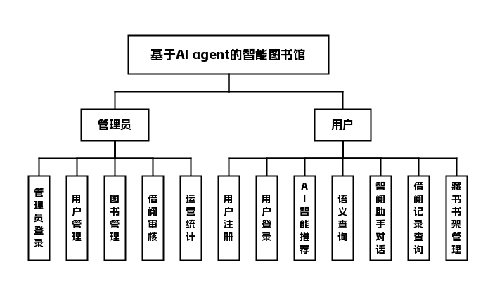

## 三、技术栈说明

前端：Vue3、Element Plus

后端：Java17、SpringBoot3、Spring Security、JWT、langchain4j向量化

数据库与中间件：MySQL、Redis、Qdrant向量数据库

其他：DeepSeek API

## 四、核心模块介绍

### 管理员端

#### 管理员

- 功能点表格

| 功能模块 | 功能描述 |
| --- | --- |
| 管理员登录 | 管理员通过账号密码及安全验证登录后台管理系统 |
| 用户管理 | 查看、编辑、禁用或删除用户账号，管理用户角色权限 |
| 图书管理 | 新增、编辑、下架图书信息，维护馆藏数据 |
| 借阅审核 | 审核用户的借书申请，确认归还操作，处理逾期记录 |
| 运营统计 | 查看图书借阅量、热门图书、用户活跃度等统计数据 |

##### 界面展示

用户管理页：管理系统用户账号，控制账号启用状态

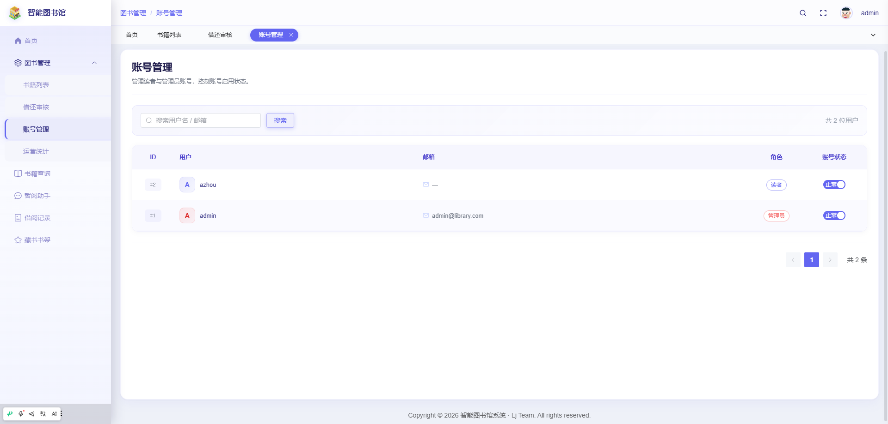

图书管理：管理员管理馆藏图书，支持新增编辑删除操作

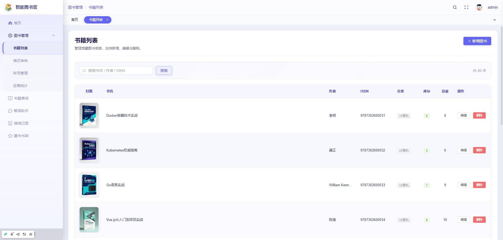

借阅审核页：查看全馆借阅动态，按状态筛选借还记录

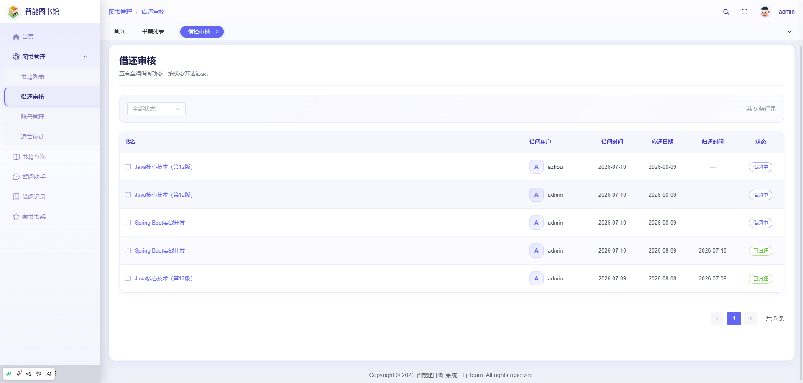

运营统计页：查看智能图书馆各类运营统计数据

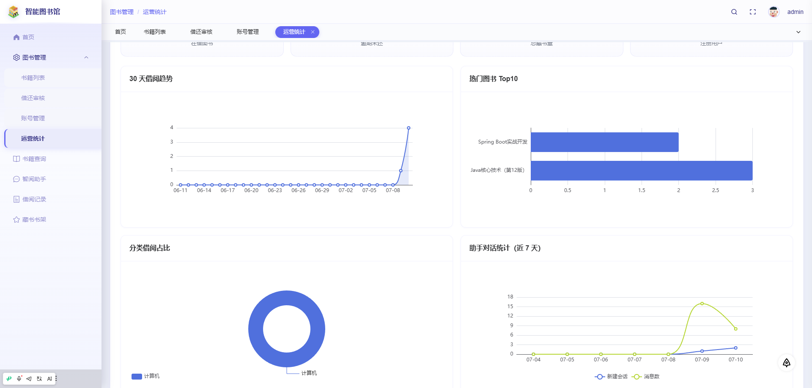

### 用户端

#### 用户

- 功能点表格

| 功能模块 | 功能描述 |
| --- | --- |
| 用户注册与登录 | 用户自主注册账号并进行安全登录 |
| 首页 AI 智能推荐 | 基于用户阅读偏好与历史行为，推荐个性化图书 |
| 语义查询 | 通过自然语言描述查找图书，系统基于向量进行语义匹配 |
| 智阅助手 | AI 智能体聊天助手，用户可通过对话完成借书、还书、收藏等操作 |
| 借阅记录 | 查看个人借阅历史、当前借阅状态与应还日期 |
| 藏书书架 | 收藏感兴趣的图书，构建个人书架 |

##### 界面展示

登录页：用户输入账号密码，登录智能图书馆系统

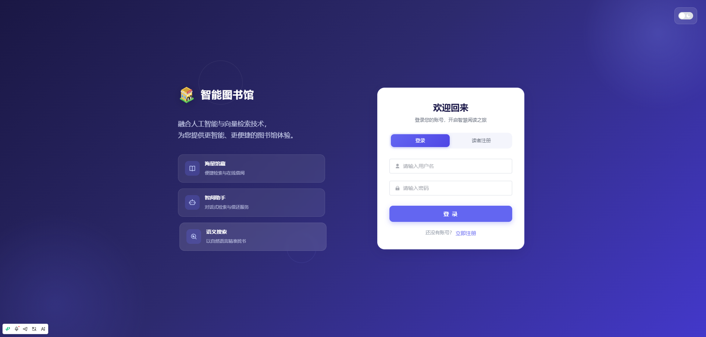

首页：展示AI推荐书籍，提供核心功能入口

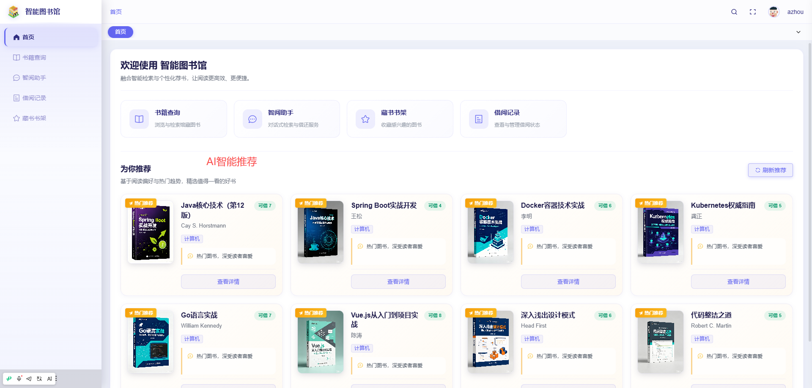

书籍查询页：通过检索筛选，查找符合需求的馆藏图书

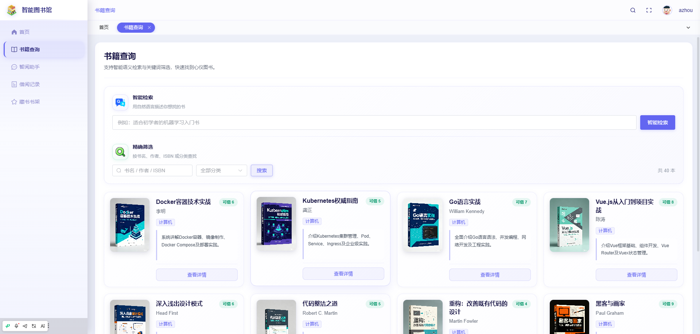

详情页：展示图书详情，支持借阅、收藏与评论

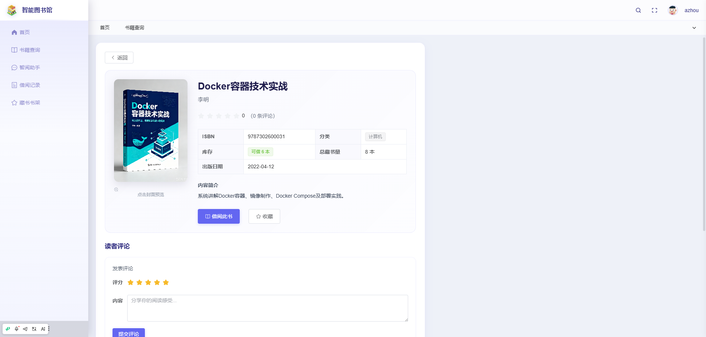

智阅助手页：和AI智阅助手交互，完成Java书籍推荐与借阅

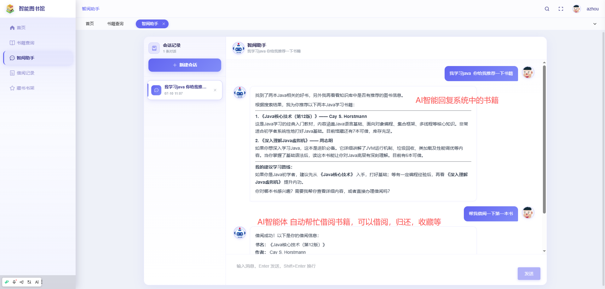

藏书书架页：展示用户收藏的图书，方便查阅与借阅

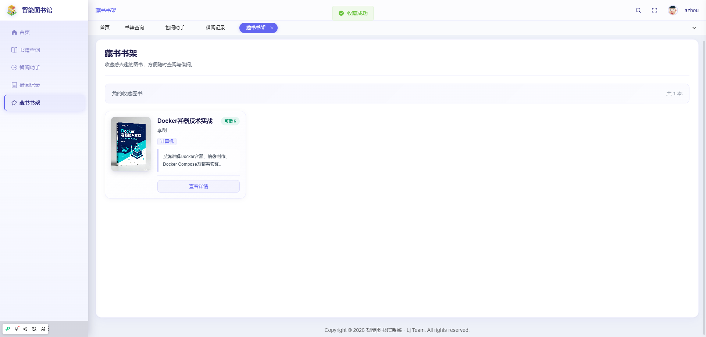

借阅记录页：查看个人借阅记录，支持在线归还操作

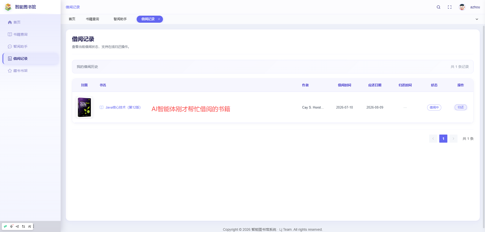

## 五、主要业务流程

1. 用户访问系统首页，进行注册或登录操作，系统通过 JWT 进行身份认证。
2. 用户在首页浏览 AI 智能推荐的图书列表。
3. 用户输入自然语言查询意图，例如“找一本关于人工智能的科普书”。
4. 系统通过 langchain4j 对查询语句进行向量化处理。
5. Qdrant 向量数据库基于语义相似度召回候选图书。
6. 系统返回语义匹配结果，用户选择目标图书。
7. 用户通过智阅助手发起借书请求，例如“帮我借这本书”。
8. 智阅助手调用 DeepSeek API 理解用户意图，并触发借阅流程。
9. 系统生成借阅申请，并更新 Redis 缓存中的图书状态。
10. 管理员在后台查看借阅申请，进行审核通过或拒绝操作。
11. 审核通过后，系统更新 MySQL 中的借阅记录。
12. 用户可在借阅记录模块查看借阅状态，并在藏书书架中收藏图书。
13. 用户阅读完成后，通过智阅助手或手动操作完成还书流程。
14. 系统更新图书库存与借阅历史，并同步至运营统计数据。

## 六、项目拓展性

- 可扩展接入更多大语言模型，如本地化部署模型，提升数据隐私性与响应速度。
- 可增加移动端适配或独立小程序，提供更便捷的访问入口。
- 可引入图书评分与评论系统，结合用户画像优化推荐算法。
- 可扩展基于用户行为的智能催还、逾期提醒等自动化通知服务。
- 可支持多馆区协同管理，实现馆际互借与统一资源调度。
- 可进一步丰富向量化检索能力，支持按作者、出版社、主题等多维度混合查询。
- 可增加管理员数据可视化大屏，提升运营分析与决策效率。

## 代码说明 
本仓库为项目的 **后端核心代码部分** 主要用于展示系统的业务设计思路与后端实现方式 出于学习展示与版权保护考虑 前端实现、完整数据库脚本及部署配置未在本仓库中公开 

##  项目交流 
本项目用于学习展示 如需项目完整功能演示、答辩说明或技术交流 请前往作者 GitHub 主页查看联系方式